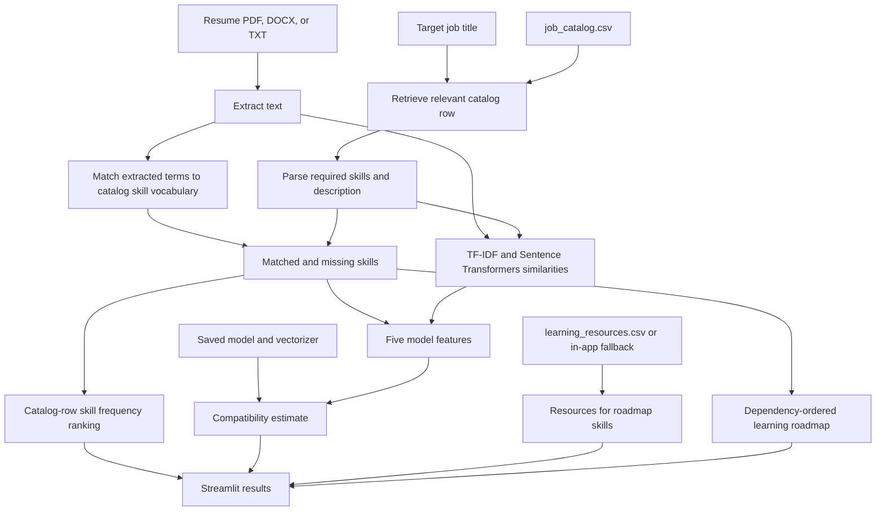
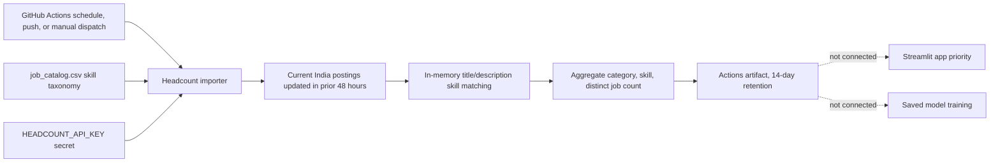

# Architecture and workflows

## Application flow

The app loads the checked-in model artifact and catalog at runtime. It does not train the model. Skill-gap priority uses the frequency of each skill in catalog rows, including repeated/template rows. The model output is clipped to 0–100 for display. The displayed feature contributions explain the saved model's prediction; they are not causal effects.

## Daily skill-demand workflow

The importer deduplicates records by `job_id`, checks the snapshot watermark across pages, and fails rather than silently accepting a truncated over-cap page walk. Its default maximum is 250 unique jobs (the CLI allows 1–1,000); page size is at most 250. Output contains aggregate counts only. The checked-in job catalog and model are unchanged by this workflow.

## GitHub Actions behavior

| Workflow | Triggers | Work performed | Output |
| --- | --- | --- | --- |
| `Model and app validation` | Manual dispatch; selected code/model/test changes on `feature/daily-job-data-pipeline`; matching pull requests to `main` | Runs `tests/` unit and saved-model checks and verifies the initial Streamlit render | CI result only; no model training |
| `Daily India skill demand` | Pushes to `feature/daily-job-data-pipeline`; manual dispatch; daily schedule at 02:17 UTC | Runs importer tests, calls Headcount with `HEADCOUNT_API_KEY`, creates bounded aggregate | Actions artifact named with the run ID, retained 14 days |

GitHub scheduled workflows run from the repository's default branch. The daily workflow explicitly checks out `feature/daily-job-data-pipeline`; make sure the intended workflow file and branch state are available in the default branch before expecting the schedule to run. Push and manual triggers are separately defined in the workflow. API credentials and a successful live import have not been established by the model-validation run.

## Important boundaries

- No independently human-labelled resume/job holdout is included. Existing regression metrics compare predictions with programmatically generated targets.
- The Headcount aggregates are not wired into app rankings and are not training labels.
- The daily pipeline does not publish descriptions, update the production catalog, or retrain/overwrite the saved model.
- Resume files are processed by the app. Review the hosting provider's storage, logging, access, and retention behavior before accepting real resumes.
